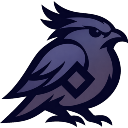

# Nighthawk

<div align="center">

</div>

Nighthawk is a Python library that makes natural-language judgment composable with ordinary Python functions.

Use Natural blocks for interpretation, classification, and other judgments; combine actions, constraints, and verification through Python functions and existing libraries.
Python owns the surrounding control flow, state, and recovery.
The same typed boundaries support provider-backed LLM calls and coding-agent executions.

```py
import nighthawk as nh


def python_average(numbers: list[float]) -> float:
    return sum(numbers) / len(numbers)


step_executor = nh.AgentStepExecutor.from_configuration(configuration=nh.StepExecutorConfiguration(model="openai-responses:gpt-5.6-luna"))

with nh.run(step_executor):

    @nh.natural_function
    def calculate_average(numbers: list[object]) -> float:
        result: float = 0.0
        """natural
        Map each element of <numbers> to the number it represents,
        then compute <:result> by calling <python_average> with the mapped list.
        """
        return result

    print(calculate_average([1, "2", "three", "cuatro"]))  # 2.5
```

Natural interprets the input, a Python helper calculates the average, and Pydantic validates the output binding.
Validation constrains the result's type, not the accuracy of the interpretation.
See [Philosophy](philosophy.md) for the design rationale.

## Getting started

- **[Quickstart](quickstart.md)** -- Setup and first example. Start here.
- **[Natural blocks](natural-blocks.md)** -- Learn what Natural blocks are: bindings, functions, writing guidelines, and binding function design.
- **[Executors](executors.md)** -- Choose an execution backend: Pydantic AI provider, coding agent, or custom.

## Patterns and verification

- **[Patterns](patterns.md)** -- Apply Natural blocks in real workflows: outcomes, deny frontmatter, async, cross-block composition, resilience.
- **[Verification](verification.md)** -- Mock tests, integration tests, prompt inspection, and OpenTelemetry tracing.

## Configuration

- **[Pydantic AI providers](pydantic-ai-providers.md)** -- Provider-specific installation, model identifiers, credentials, and model settings.
- **[Coding agent backends](coding-agent-backends.md)** -- Claude Code and Codex backend configuration, skills, and MCP tool exposure.
- **[Runtime configuration](runtime-configuration.md)** -- Configure scopes, select models, and embed Nighthawk in a host application.

## Reference

- **[Specification](specification.md)** -- Runtime contracts and boundaries.
- **[API Reference](api.md)** -- Auto-generated API documentation from source docstrings.
- **[For coding agents](for-coding-agents.md)** -- Condensed, decision-oriented development reference for coding agents (LLMs) building Python projects with Nighthawk.

## Background and project

- **[Philosophy](philosophy.md)** -- Function composition, delegated judgment, human and agent authorship, constraints, and Core responsibility.
- **[Design drivers](design-drivers.md)** -- Representative application needs, workspace information ownership, and development tooling as an application.
- **[Roadmap](roadmap.md)** -- Future directions and open questions.

## Origins

Nighthawk is a compact reimplementation of the core ideas of [Nightjar](https://github.com/psg-mit/nightjarpy).
